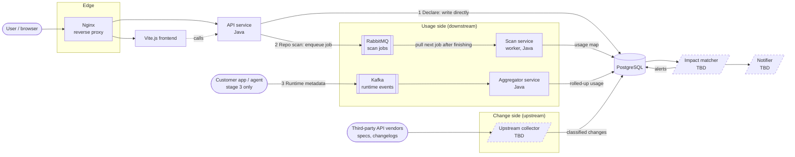

# Driftline: Architecture (high level)

> Status: DRAFT. Reflects the owner's sketch and decisions so far. Dashed boxes and the "Open" section are not decided.

## Stack (decided)

Java (backend), Vite.js (frontend), RabbitMQ (job queue), Kafka (runtime event stream), PostgreSQL (only database), Nginx (reverse proxy), Docker.

## Diagram

## Data flow by input path

| Path | Stage | Flow | Notes |
|---|---|---|---|
| Declare | 1 | API → Postgres | No queue, no scan |
| Repo scan | 2 | API → RabbitMQ → Scan service → Postgres | Worker pulls next job after finishing the current one |
| Runtime | 3 | Client → Kafka → Aggregator → Postgres | Metadata only. Separate service from scan |

Alerts should carry a confidence label by source: declared, found in code, seen in traffic.

## Services

| Service | Role | Consumes | Writes |
|---|---|---|---|
| API | Auth, projects, declare, enqueue scans, serve UI data | HTTP | Postgres, RabbitMQ |
| Scan service (worker) | Clone and statically analyze repos | RabbitMQ | Postgres |
| Aggregator | Roll up runtime call metadata | Kafka | Postgres |
| Upstream collector (TBD) | Fetch and diff vendor specs and changelogs | Vendor sources | Postgres |
| Impact matcher (TBD) | Join usage with changes to produce alerts | Postgres | Postgres |
| Notifier (TBD) | Send alerts (email, Slack, etc.) | Alerts | External channels |

## Open (owner decides)

- Upstream collector design and where it sits (scheduler, queue, output shape)
- Whether impact matcher and notifier are separate services or part of the API
- Scan worker safety limits: clone size, timeouts, read-only handling of untrusted repos
- Idempotency of repeated scans of the same repo
- RabbitMQ consumer timeout and heartbeat for long scans
- GitHub app webhooks to trigger rescans on push
- Runtime collection method: SDK, log ingestion, or proxy (metadata only)
- Frontend framework on top of Vite
- Scan target language for v1
